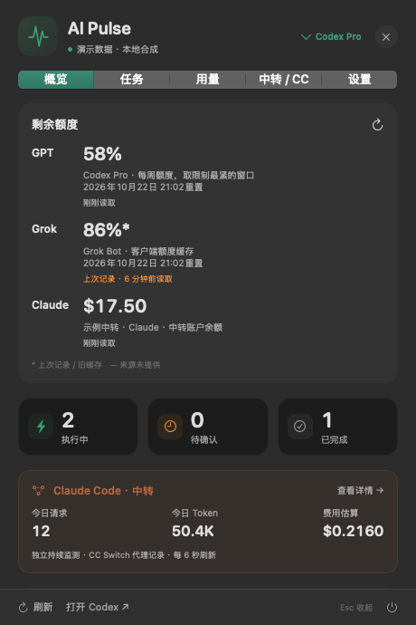
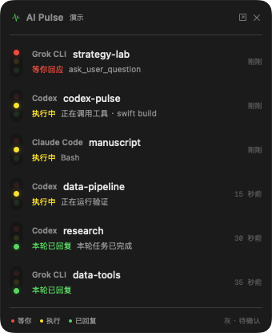
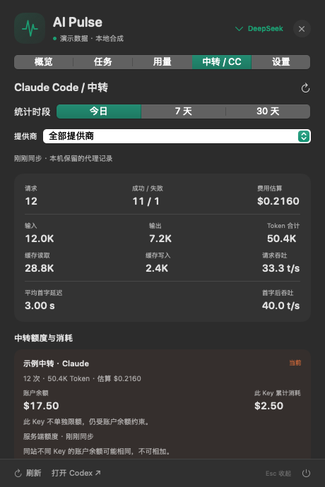
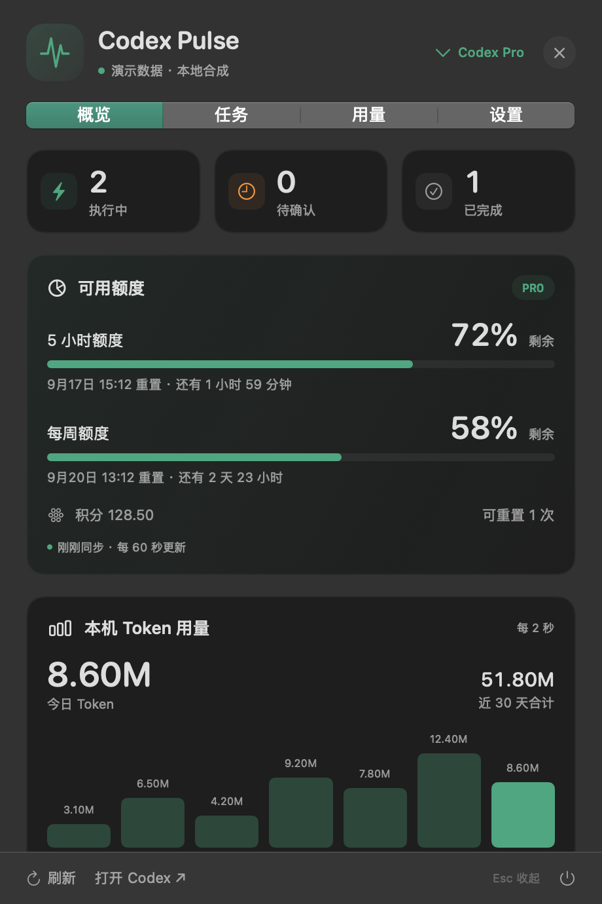
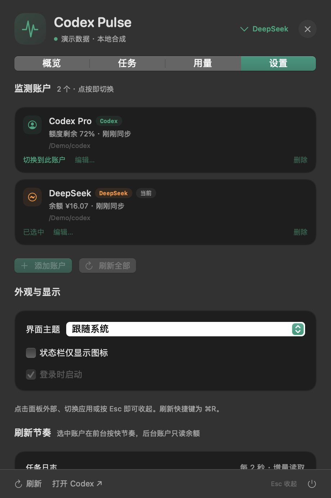

# AI Pulse

一个原生 macOS 菜单栏小工具，直接显示 GPT / Codex、Grok Bot 的剩余额度数字，点开查看来源、重置时间、Claude 当前中转额度、DeepSeek 余额、Token 用量与本机任务。SwiftUI + AppKit，中文界面，支持系统浅色 / 深色外观，无第三方运行时依赖。



## 能看到什么

- **菜单栏**：上下两行显示剩余百分比，上行 `GPT 96%`、下行 `Grok 66%`，无图标或 Claude。悬停及点击展开可查看完整额度、来源、更新时间和旧缓存标记；`—` 表示来源未返回剩余额度。
- **多账户**：可同时登记多个账户，每个账户绑定一个 Codex 数据目录，面板右上角快速切换，设置页新增 / 编辑 / 删除。
- **DeepSeek 余额**：余额、赠送 / 充值拆分、账户是否可用、今日观测消耗（本机运行期间抓到的余额变化）。
- **Token 用量**：按本机 Codex 日志统计每次请求的增量 Token，按事件时间归入本地日期，并可查看输入 / 缓存命中 / 输出与按模型拆分。
- **额度**：按服务端实际返回的窗口展示剩余比例、重置时间、多模型额度、积分余额，以及可用 Reset 次数和每次到期时间。
- **任务**：本机最近 60 个未归档会话的标题、项目、模型、活动、执行状态、本轮 / 会话累计 Token、最近输入上下文占比。
- **账号使用**：累计 Token、连续使用天数、最近 7 个有记录日期的 Token 柱状图。
- **设置**：账户列表与编辑器、跟随系统 / 浅色 / 深色主题、可选悬浮窗、登录时启动、每个账户的数据目录与 CLI 路径。开机启动默认关闭。

## 0.5.4 上下两行状态栏


- GPT 在上、Grok 在下，均保留百分号；使用紧凑的双行文字，按最长一行计算状态栏宽度。
- 保留原有每 60 秒主动查询、手动刷新和悬停详情。

## 0.5.3 Grok 主动查询额度

- GPT 与 Grok 均每 60 秒主动查询服务端额度，点击刷新或按 ⌘R 可立即重查。Grok 使用桌面客户端相同的 `GetSandUsageStatus` 接口，不发起模型请求。
- 首次在展开页或设置中点「授权并刷新 Grok」，按 macOS 钥匙串提示允许读取 `Grok Bot Safe Storage`。自动轮询不会弹出授权提示；未授权、网络失败或登录过期时，保留并标明上次记录和来源。
- 只读取 Grok Bot 当前账号的登录 Token；只向原服务 `https://api2.cursor.sh` 发出额度请求，禁止重定向，不保存凭据、响应正文或原始错误。不会读取或轮换客户端的 Refresh Token，也不改写其登录文件；登录过期时请打开 Grok Bot 确认登录。
- 成功读数注明「服务端额度」和查询时间；本地缓存作为备用来源，仍每 2 秒读取一次。切换账户或团队时丢弃旧的查询结果；状态栏保持 `GPT 96%；Grok 66%`。

## 0.5.2 精简状态栏


- 状态栏固定使用 `GPT 数字%；Grok 数字%`，移除图标、缓存星号和 Claude。数字仍为原来源的剩余百分比，来源、旧缓存标记与读取时间可在悬停和展开页查看；未知值仍显示 `—`。
- Claude 中转监控和展开页继续可用，原有账户与设置保留。

## 0.5.1 状态栏显示三家剩余额度

- 菜单栏固定显示 GPT、Grok、Claude，取代活跃任务数 / 今日 CC 请求数。点击状态栏总是打开「概览」，顶部直接展开三家的读数、来源、重置时间、同步时间和缺失原因；任务与中转明细继续保留。
- GPT 显示 Codex 账户最紧额度窗口的剩余比例。详情切到 DeepSeek 等账户时，仍为一个 Codex 账户保留额度连接；后台只轮询额度，不持续解析该账户的任务日志。
- Grok 显示桌面 Grok Bot 当前账户的额度缓存；旧缓存加 `*`，详情显示真实读取时间。Claude 只采用 CC Switch **当前提供商**返回的账户余额，或明确标为 `Key` 的独立限额；不选其他中转替代，也不把累计消耗或「Key 不限额」当成余额。
- 当前中转未返回余额时，Claude 显示 `—` 并在展开页解释。保留服务实际给出的货币 / 单位，不把三家额度相加。
- 升级后默认只显示状态栏，悬浮灯移为设置中的可选功能；重新开启后仍能记住位置。旧的仅图标偏好保留在本机，但不再隐藏三家额度文字。

## 0.5.0 悬浮状态灯与 Grok



- 新增原生置顶浮窗，拖动空白处移动，位置自动保存；点击任务打开主面板，右上角隐藏后可从「设置 → 悬浮状态灯」重新显示。每个会话独立亮灯，按等待回应、执行、待确认、已回复排序，最多显示 8 行。
- 红灯：有明确的等待输入 / 权限事件；黄灯：正在执行；绿灯：就绪 / 本轮已回复；灰灯：状态待确认。无新事件超过两分钟不会自动判为完成；已关闭和过旧会话退出浮窗。
- Codex 复用现有本机日志，不修改 Codex 配置。Claude Code 和 **Grok CLI** 通过本地事件独立采集，任务页和概览也可查看。Grok 的旧轮次结束事件与子任务事件不会结算当前主会话；继承的 Claude hooks 不会把 Grok 误记为 CC。
- **桌面 Grok Bot** 独立显示客户端在线 / 登录状态、当前账户的额度剩余比例、重置时间和缓存读取时间。来源是客户端自己的 `desktop-status.json` 与 `sand-client-persistence` 中的账户指针 / `weekly-usage.cache`；超过五分钟标注「上次记录」。不读取 secrets、对话、草稿或浏览器存储，不发起额外模型或额度网络请求。
- 桌面客户端缓存没有明确的任务运行状态，所以其浮窗条目显示灰灯「客户端在线 · 任务状态未提供」；不把客户端进程存在解释成某个 Bot 正在执行。桌面客户端与 Grok CLI 的状态来源分开展示。
- 在设置中可分别启用 / 移除 Claude Code、Grok CLI 状态采集。启用时备份并合并 `~/.claude/settings.json` 与 `~/.grok/hooks/ai-pulse.json`，只移除自己的 handler，保留其他设置与 hooks；新开会话后生效。已有 CC Switch 用量与余额监控保持独立。
- hook 直接调用已安装 App 的无界面事件入口，只保留会话 ID、项目目录、工具名、轮次 ID 和状态；不保存提示词、工具参数、工具输出、回答或错误正文，不输出审批决定，不监听网络端口。状态保存在权限受限的 `~/.local/share/ai-pulse/agent-sessions/`，按来源 + 会话哈希隔离并加锁原子更新。

已安装后也可运行以下命令安装 / 移除采集（设置界面提供相同功能）：

```bash
"$HOME/Applications/AI Pulse.app/Contents/MacOS/CodexPulse" --install-agent-hooks
"$HOME/Applications/AI Pulse.app/Contents/MacOS/CodexPulse" --remove-agent-hooks
```

状态灯是本机可观测事件的提示。`Stop` 表示本轮回复触发了结束 hook；其他阻塞式 Stop hooks 仍可能让助手继续，后续活动会重新变黄。桌面 Grok Bot 适配核对自本机 0.71.2 的缓存格式；升级后格式不兼容时显示未知，不猜测数值。

## 0.4.0 AI Pulse：同时监控 Codex 与 Claude Code



- 原 Codex Pulse 改名为 **AI Pulse**，保留原 bundle identifier，已有账户、主题、目录映射、钥匙串和 Reset 记录继续使用。
- Claude Code 监控独立运行，不随 Codex 账户选择启停。概览卡和状态栏同时显示今日 CC 代理请求，新增「中转 / CC」页。
- 每 6 秒只读 `~/.cc-switch/cc-switch.db`，统计今日 / 7 天 / 30 天的代理请求、成功与失败、输入 / 输出 / 缓存读取 / 缓存写入 Token、USD 费用估算，并按提供商或模型查看最近请求。
- 每 60 秒使用 CC Switch 中相应提供商的凭据查询已核验的 **4Router / ZZS** `GET /api/usage/token/`；同时读取公开 `/api/status` 的 `quota_per_unit`、`quota_display_type` 和汇率后转换显示。缺少转换元数据时保留原始额度单位。
- 账户余额、Key 剩余额度、Key 累计消耗分别标注。Key 的 `unlimited_quota` 仅表示 Key 不单独限额，不能解释为账户余额无限；缺少账户余额时明确显示接口未返回。同站不同 Key 的账户余额不可相加。
- 请求吞吐 = 上游输出 Token / 整次请求耗时；首字后吞吐 = 输出 Token /（整次耗时 − 首字延迟），仅统计成功流式请求且首字后区间至少 250 ms 的记录。按总 Token / 总时间加权。上游缓冲、思考 Token 与网络会影响数值，均不能当成服务端纯生成速度。
- 只统计 `app_type=claude`、`data_source=proxy`，排除 Claude Desktop 和 Codex 记录；导入的会话记录数量单列，避免与代理重复统计。历史数据限 CC Switch 尚保留的请求，不回填已清理记录。
- CC Switch 费用是本地价格表及倍率的估算，与中转服务端扣费分开；人民币与美元不合并。请求库或余额查询失败显示失败 / 未知，过期余额标为上次记录。

使用 [CC Switch 用量记录的字段与数据源](https://github.com/farion1231/cc-switch/blob/main/docs/user-manual/en/4-proxy/4.4-usage.md)，不修改代理、不安装 Claude hooks、不发起模型请求。余额凭据只在查询时从数据库提取到内存，不进入偏好、日志、诊断、截图或仓库；禁止凭据请求跟随重定向。设置可关闭中转额度网络查询。

安装脚本将旧版本压缩备份至 `~/.local/share/ai-pulse/backups/`，退出旧进程后替换为 `~/Applications/AI Pulse.app`，避免旧名称应用副本继续出现在 Spotlight。

## 0.3.1 Reset 到期记录

- Codex 账户的额度卡显示服务端返回的可用 Reset 次数，并按到期时间排列每张可用 Reset。时间按本机时区显示。
- 最近一次成功读取的次数和到期时间保存在本机 UserDefaults，重启后仍可查看。断线、快照过期或到期时间已过时标为“上次记录”，不把历史次数当成当前可用次数；重新连接后以服务端数据覆盖。切换登录账户或修改监测目录时清除旧记录。
- 如果服务端只给出次数、没有逐张到期时间，界面明确写出缺少多少条明细；没有返回 Reset 字段时保持未知，不显示为零。

## 0.3.0 多账户与 DeepSeek 适配

- 账户分两种类型：**Codex**（ChatGPT / Codex 登录，额度与账号用量来自 app-server）和 **DeepSeek**（余额来自官方余额接口，用量来自本机日志）。同一个数据目录可以按需要分别登记成两种类型。
- DeepSeek 账户不启动 app-server：把 `model_provider` 切到 DeepSeek 之后，Codex 的额度接口已经不可用（返回 `codex account authentication required`）。
- 余额每 30 秒刷新；本机任务一完成立即补一次刷新。Token 用量每 2 秒增量读取 Codex 日志，不重复解析整个文件。
- 用量归属按每轮 `turn_context` 的模型名判定。切换提供商之后，同一份日志里会同时存在 DeepSeek 轮次和其他模型轮次，此时只有 DeepSeek 轮次计入 DeepSeek 账户。
- 切换账户会先丢弃上一个账户的快照，不会出现 A 账户数字留在 B 账户名字下面的情况。后台账户只按 10 分钟读取 DeepSeek 余额，Codex 账户保留上次快照直到切换过去。

Codex 账户保留原有额度卡，并新增本机 Token 用量卡：



设置页管理账户、切换与查看每个账户的实时摘要：



## 0.2.1 目录打开修复

- 任务按钮统一为“在 Finder 中打开”，详情显示实际目录。
- 旧目录移动或删除后明确提示，可选择并记住新位置；右键任务可“更改项目目录…”。同一旧路径的任务共用映射，仅保存在本机，不修改 Codex 历史记录。
- 明确指定 Finder，异步打开；失败和 10 秒未返回结果均显示提示，避免一直无反馈。超时不代表系统请求已取消，它仍可能稍后完成。

## 0.2.0 交互与界面

- 点击面板外部、切换应用或按 Esc 自动收起；右上角也有收起按钮。没有固定展开模式。
- 四个页面：概览、任务、用量、设置。任务搜索支持名称、项目路径、模型和会话 ID；多个关键词同时匹配。
- 支持全部 / 执行中 / 待确认 / 已完成 / 已中断 / 未知筛选，按任务状态、最近更新或累计 Token 排序。
- 点击任务展开详情，查看本轮 Token、上下文占比；可在 Finder 中打开目录或复制会话 ID。
- 额度显示重置倒计时、同步新鲜度和更新中状态；⌘R 立即刷新。
- 登录项与账号配置沿用已有设置。旧刘海面板及其开关已移除。

## 运行

需要 macOS 14+、Swift 5.9+ 编译器（测试需要 Swift 6+）以及已登录的 Codex CLI。当前已在 Apple Silicon、Codex CLI 0.154.0 上验证。Codex 的 App Server 与本地日志格式会变化；遇到不兼容数据会显示不可用。

```bash
git clone git@github.com:Yuwangzhi/codex-pulse.git
cd codex-pulse
./scripts/build.sh --install
```

脚本构建 `dist/AI Pulse.app`，复制到 `~/Applications/AI Pulse.app` 并启动。应用仅在状态栏显示，不占 Dock。安装时自动退出并备份旧版本。

仅构建：`./scripts/build.sh`。安装脚本会自动退出旧版本并备份。退出：面板右下角电源按钮。卸载：退出后移除该 App；如果启用了登录时启动，先在设置中关闭。

本地构建使用 ad-hoc 签名，未经过 Apple 公证。分发到另一台 Mac 建议在目标机器上从源码构建。

## 数据来源与口径

| 内容 | 来源 | 刷新 |
| --- | --- | --- |
| Codex 账号额度 | `codex app-server` → `account/rateLimits/read` | 每 60 秒及额度通知后 |
| Codex 账号 Token | `account/usage/read` | 每 5 分钟 |
| DeepSeek 余额 | `GET {base_url}/user/balance` | 每 30 秒、任务完成后及 ⌘R |
| DeepSeek Token 用量 | 本机 rollout JSONL 的 `token_count` 增量 | 每 2 秒 |
| 会话列表 | `CODEX_HOME/state_*.sqlite`，只读连接 | 每 2 秒 |
| 任务活动 | 对应 rollout JSONL，增量读取完整行 | 每 2 秒 |

使用 [OpenAI 官方 App Server 文档](https://learn.chatgpt.com/docs/app-server) 中的账号查询接口。Pulse 启动独立的查询进程，复用 Codex 自己的登录流程；不调用模型任务接口，不自动消费额度重置次数。退出后关闭自己的查询进程。

**任务状态是本机日志观测，不是桌面应用的全局运行状态 API。** 最近 120 秒内的未结束活动显示“执行中”；超过 120 秒没有新事件显示“待确认”，工具可能仍在执行；只有 `task_complete` / `turn_aborted` 才显示完成 / 中断。某些审批等待没有可用日志事件，因此不猜测“等待审批”。云端和其他设备的任务不在本机任务列表内，账号统计则采用服务端返回的账号范围。

首次最多读取每个日志的末尾 4 MiB，此后只读取新增字节。历史上下文被截断时，无法恢复的字段保持未知。只读最近 60 个未归档会话；早于此范围的长任务可能不显示。会话 Token 使用累计值覆盖，避免把每次上报的累计数重复相加。本轮 Token 取 `turn_token_usage`，旧格式没有该字段则显示 `—`。上下文占比取最近请求的输入 Token / 上下文窗口，是近似指标。

额度窗口使用服务端实际时长，**不假设一定有“5 小时 + 每周”两种额度**。过了重置时间不会自行恢复为 100%，需要下一次服务端快照。积分是服务端的 credits 单位，不代表美元或剩余 Token。未返回的余额、百分比和计数均显示未知；不把缺失值当成 0。账号每日统计保留服务端日期，不承诺自然日时区，也不将最后一个日期冒充“今日”。

**Token 用量口径。** 计的是每次请求的增量（`event_msg` → `token_count` → `last_token_usage`），不是本轮累计值，也不是 `threads.tokens_used`：压缩会重置累计计数，实测一份 1.33 GB 日志里 `tokens_used` 只有逐次增量求和的五分之一。只统计**这台机器**记录的请求，网页端、其他设备和其他数据目录的调用不在其中；日期按运行本机时区归集。超过 256 MiB 的日志首次只读取尾部，界面会提示有多少份日志被截断、更早轮次可能未计入。

**DeepSeek 的口径。** 官方接口只提供余额，没有用量查询（`/user/usage` 等路径返回 404），所以余额是服务端真值，用量是本机观测值，两者口径不同、不能互相推导。余额按账户的 `balance_infos` 展示，优先取 CNY；「今日观测消耗」来自 Pulse 运行期间抓到的当日首末余额差，未运行的时间段不回算，当天只有一次采样时不显示。

## 隐私

Pulse 不读取也从不保存 `auth.json`、账号邮件或会话正文，不上传本机任务信息。CLI 自行处理 Codex 登录与额度网络查询。

DeepSeek 余额请求需要凭据，处理方式是：优先使用你在设置里填写、保存在 **macOS 钥匙串**里的 API Key；没有时按该账户自己的 `config.toml` 读取 `model_providers.<name>` 的 `experimental_bearer_token`，或按其中的 `env_key` 读取环境变量。凭据只在发起请求时于内存中使用，**不写入磁盘、不写日志、不进入界面，也不出现在 `--diagnose` / `--usage-check` 输出里**；设置页只显示来源（钥匙串 / config.toml / 环境变量），不显示内容，并可一键清除钥匙串中的 Key。

日志解析会在内存中解码事件，仅投影任务状态、工具名和用量；原始记录不落盘。会话标题只在本机 UI 展示。仓库不包含真实会话、余额快照或凭据，截图使用明确标记的虚构演示数据。

设置和 Codex Reset 的最近一次次数、到期时间保存在 macOS UserDefaults。不写入 Codex 配置或会话库；Codex 查询进程自身仍可能按其正常行为维护运行时元数据。

## 开发与验证

```bash
./scripts/swift-tool.sh build
./scripts/swift-tool.sh test
./scripts/build.sh
"dist/AI Pulse.app/Contents/MacOS/CodexPulse" --diagnose
"dist/AI Pulse.app/Contents/MacOS/CodexPulse" --usage-check
"dist/AI Pulse.app/Contents/MacOS/CodexPulse" --demo --show --ui-check
"dist/AI Pulse.app/Contents/MacOS/CodexPulse" --demo --dark --screenshot /tmp/pulse-dark.png
"dist/AI Pulse.app/Contents/MacOS/CodexPulse" --demo --screenshot /tmp/pulse-relay.png --tab 4
"dist/AI Pulse.app/Contents/MacOS/CodexPulse" --demo --kind codex --dark --screenshot /tmp/pulse-codex.png
"dist/AI Pulse.app/Contents/MacOS/CodexPulse" --demo --dark --screenshot /tmp/pulse-usage.png --tab 2
```

`--diagnose` 运行 20 秒后退出，`--usage-check` 运行 12 秒。两者按账户输出连接状态、额度 / 余额是否可用、最近一次 Reset 次数与逐张到期时间，以及用量账本读取的日志份数、日期与 Token 合计（`--usage-check` 另给最近日期明细与凭据来源），不输出凭据本身、标题、账号 ID、Reset ID、积分或日志正文。演示模式不连接 CLI、不联网、不读取本机会话；`--demo --kind codex` 选择演示里的 Codex 账户，默认是 DeepSeek 账户。`scripts/swift-tool.sh` 为部分 Command Line Tools 版本补全其自带 SwiftPM 框架搜索路径，所有设置仅影响当前构建进程。

`--show` 打开实际状态栏弹窗；`--ui-check` 只在标准输出记录弹窗显示 / 关闭，供原生交互验证。`--tab 0/1/2/3/4` 可选择截图页面。

测试覆盖：任务跨字段搜索、状态筛选、不同排序与稳定顺序；任务生命周期、长时间无事件、跨轮次结束事件、累计 Token 去重、缺失额度、不同时长窗口、过期重置时间、分段写入、日志截断 / 替换及有界尾部读取；`config.toml` provider 扫描与凭据优先级、DeepSeek 余额解码与端点拼接、余额历史与观测消耗、账户注册表迁移、用量账本的按日 / 按模型归集、增量与半行追加、尾部截断边界、累计回退、窗口过滤、账户类型过滤、混合会话语义。

## 目录

```text
Sources/CodexPulse/       菜单栏、SwiftUI 面板、账户运行时、Codex RPC、DeepSeek 余额客户端
Sources/CodexPulseCore/   数据模型、账户与 provider 配置、只读数据库、增量日志解析、用量账本
Tests/                   合成数据测试，不依赖真实 Codex 账号
Resources/               App 元数据
scripts/                 构建、安装、图标生成
```
